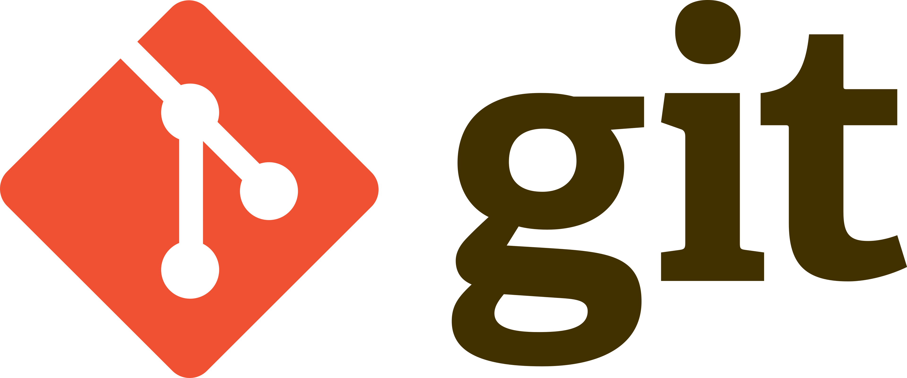

# 이재연 202630125

## 10월29일(7주차)
### 스텍의 기본개념

## 10월15일(6주차)
### 원형 연결리스트의 기본 개념


1. 기본 개념과 구조

* 의미: '쌓다', '더미'라는 뜻으로, 접시를 쌓아두거나 통에 든 감자칩을 위에서부터 하나씩 꺼내는 모습을 연상하면 쉽습니다.
* 입출구: 데이터의 삽입과 삭제가 오직 한쪽 끝(Top)에서만 일어납니다.


2. 핵심 연산

* Push (푸시): 스택의 맨 위(Top)에 새로운 데이터를 삽입하는 연산입니다.
* Pop (팝): 스택의 맨 위(Top)에 있는 데이터를 삭제(추출)하는 연산입니다.
* Peek / Top (피크/탑): 맨 위에 있는 데이터가 무엇인지 확인만 하고 삭제하지는 않는 연산입니다.
* IsFull / IsEmpty: 스택이 꽉 차 있는지 또는 비어 있는지 확인하는 상태 확인 연산입니다.


## 10월8일(5주차)
### 단순 연결 리스트의 출력 및 노드 삽입 함수 구현

```py
class Node:
    def __init__(self):
        self.data = None
        self.link = None


def printNodes(start):
    current = start
    if current == None:
        return
    print(current.data, end = ' ')
    while current.link != None:
        current = current.link
        print(current.data, end = ' ')
    print()

def insertNode(findData, insertData):
    global memory, head, currentm, pre
    current = head
    if current.data == findData:
        node = Node()
        node.data = insertData
        node.link = head
        head = node
        return

    while current.link != None:
        pre = current
        current = current.link
        if current.data == findData:
            node = Node()
            node.data = insertData
            node.link = head
            head = node
            return

    node = Node()
    node.data = insertData
    current.link = node

# 전역 변수 선언
memory = []
head, current, pre = None, None, None
dataArray = ['다현', '정연', '쯔위', '사나', '지효']

if __name__ =="__main__":
    node = Node()
    node.data = dataArray[0]
    head = node
    memory.append(node)

    for data in dataArray[1:]:
        pre = node
        node = Node()
        node.data = data
        pre.link = node
        memory.append(node)

    printNodes(head)

    insertNode("다현", "화사")
    printNodes(head)

    insertNode("사나", "솔라")
    printNodes(head)
    
    insertNode("재남", "문별")
    printNodes(head)
```


## 노드 출력 함수
* 배열(Array)은 arr[0], arr[1]처럼 인덱스 번호를 이용해 원하는 위치에 곧바로 접근할 수 있습니다. 반면, 연결 리스트는 메모리 상에 데이터가 연속적으로 존재하지 않고 서로 링크(화살표)로만 이어져 있습니다.

## 10월1일(4주차)
### 선형 리스트
## 선형 리스트 기본
* 논리적·물리적 순서 일치: 데이터가 입력된 순서대로 메모리에 연속해서 저장됩니다.
* 순차 리스트(Ordered List): 데이터 간에 1:1의 순서 관계를 가집니다.
* 배열 구현: 주로 고정된 크기의 배열을 이용해 구현합니다.
## 선형 리스트 활용
```py
kakao = ["가나", "다라", "마바", "사아", "자차"]
temp = kakao[4]
print(kakao)
kakao.append("삽입")
print(kakao)
kakao[4] = kakao[5]
kakao[5] = temp
temp = kakao[3]
print(kakao)
kakao[3] = kakao[4]
kakao[4] = temp
print(kakao)
```
## 노드(Node) 구조의 활용
```py
class Node:
    def __init__(self):
        self.data = None
        self.link = None

node1 = Node()
node1.data = "다현"

node2 = Node()
node2.data = "정연"
node1.link = node2

node3 = Node()
node3.data = "쯔위"
node2.link = node3


node4 = Node()
node4.data = "사나"
node3.link = node4


node5 = Node()
node5.data = "지효"
node4.link = node5

print(node1.data, end=', ')
print(node1.link.data, end=', ')
print(node1.link.link.data, end=', ')
print(node1.link.link.link.data, end=', ')
print(node1.link.link.link.link.data, end=' ')

print("\n\n연결리스트 출력")
current = node1
print(current.data, end=', ')
while current.link is not None: # is not None > != None
    current = current.link
    print(current.data, end=', ')

new_node = Node()
new_node.data = "재남"
new_node.link = node3 # 쯔위 노드
node2.link = new_node

print("\n\n연결리스트 출력")
current = node1
print(current.data, end=', ')
while current.link is not None: # is not None > != None
    current = current.link
    print(current.data, end=', ')

node2.link = node3 # 쯔위 노드
del(new_node)
print("\n\n연결리스트 출력")
current = node1
print(current.data, end=', ')
while current.link is not None: # is not None > != None
    current = current.link
    print(current.data, end=', ')
```

## 9월17일(3주차)
### 파이썬 기본 출력과 리스트 인덱싱.임시 변수를 활용한 데이터 삽입 및 스왑 실습 .
## 기본출력
```py
print("hello, world")
```

## 임시 변수 활용
```py
kakao = ["가나", "다라", "마바", "사아", "자차"]
temp = kakao[4]
print(kakao)
kakao.append("삽입")
print(kakao)
kakao[4] = kakao[5]
kakao[5] = temp
temp = kakao[3]
print(kakao)
kakao[3] = kakao[4]
kakao[4] = temp
print(kakao)
```


## 9월10일(2주차)
### 마크다운 문법
# h1 태그
## h2 태그
### h3 태그
...
###### h6 태그

*이텔릭체*

**볼드**

***이텔릭+볼드***
~~취소선~~


밑줄
---

1. 감자
2. 옥수수
3. 배추

* 감자
* 옥수수
* 배추
    * 배추 김치
        * 신김치

### 코드 블럭

```java
public class HelloWorld {
    public static void main(String[] args) {
        // 화면에 문장을 출력합니다
        System.out.println("Hello, Java!");
        
        int age = 20;
        String name = "홍길동";
        
        System.out.println(name + "의 나이는 " + age + "살입니다.");
    }
}
```

```py
score = 85

if score >= 80:
    print("A등급입니다.")
else:
    print("B등급 이하입니다.")

```

복사는 `Ctrl + C` 입니다.


### 링크
[구글 바로가기](https://google.com "구글 사이트")

[코드 블럭](#코드-블럭 "코드블럭 예제")


